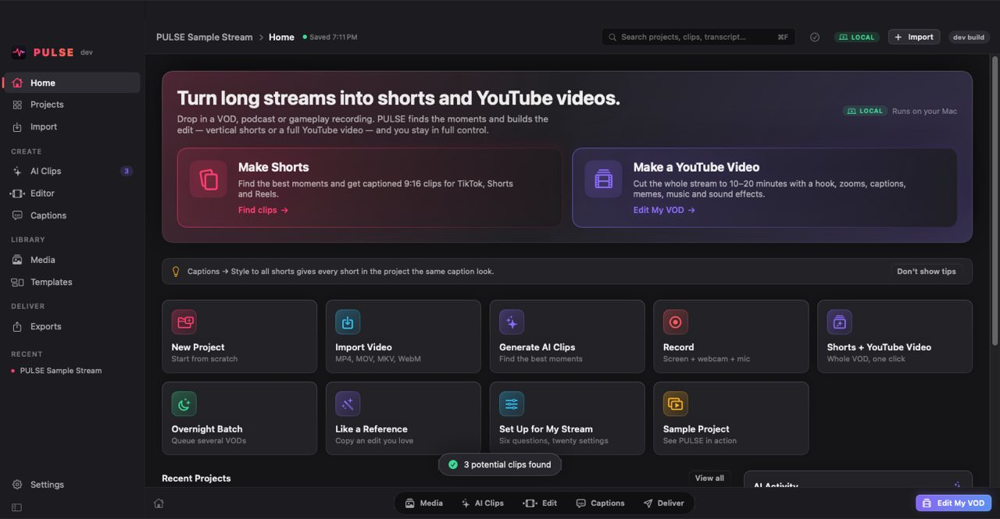
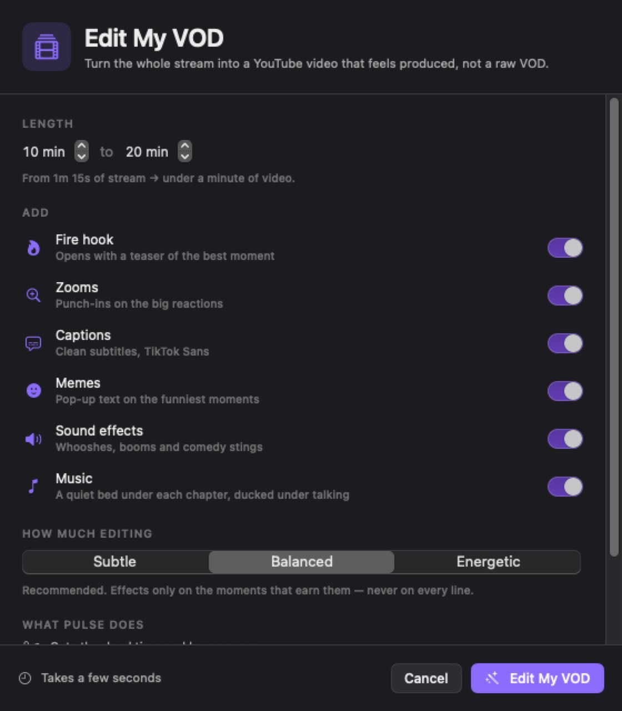
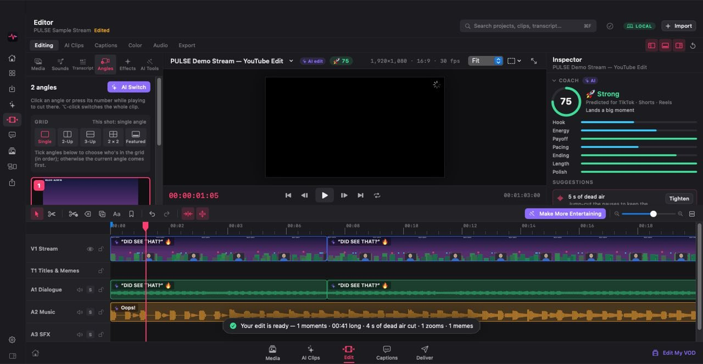
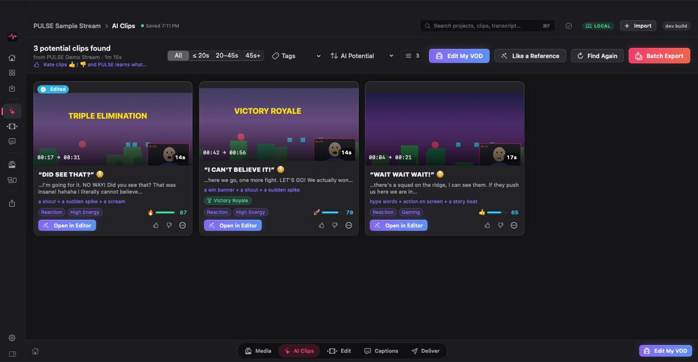
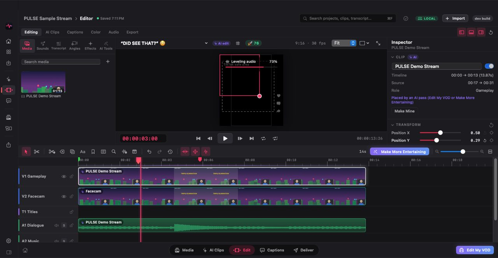
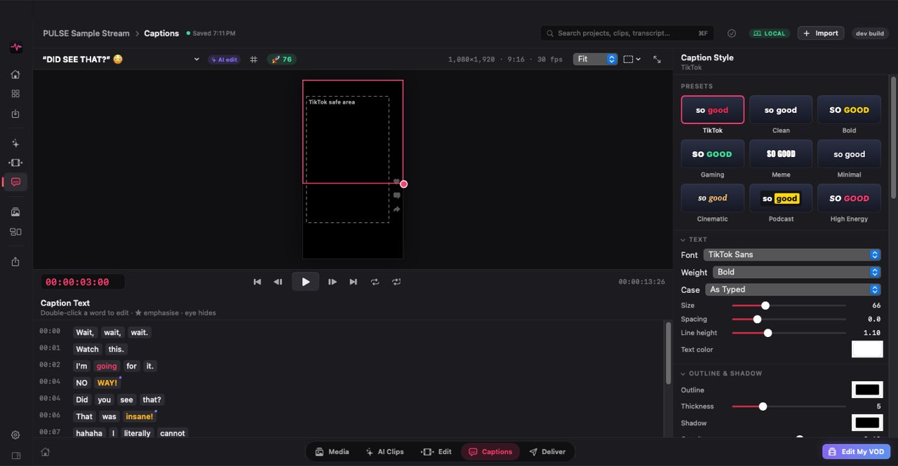
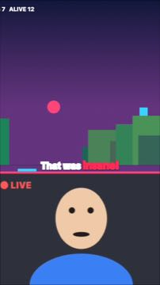
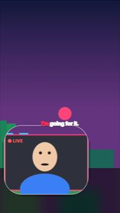

# PULSE

**AI finds the moments. AI builds the first edit. You have total control.**

PULSE is a local-first AI video clipping and short-form editor for macOS (Apple Silicon first).
Import a long stream, podcast or video. PULSE analyzes it on your Mac, finds the most entertaining
moments and builds ready-to-post vertical shorts with captions, facecam layouts and punch-ins. Every
AI decision lands on a professional timeline as normal, editable clips, keyframes and captions.

## Download

**[⬇ Download PULSE 1.6.2](https://github.com/XmanXay69/PulseAI-Clipper/releases/latest/download/PULSE.dmg)**
(macOS 14 or later, Apple Silicon and Intel) · [all versions](versions/README.md) · [release notes](versions/1.6.2/NOTES.md)

Already installed? PULSE shows an **Update** button when a new version is out — no need to download again.

**New in 1.6.2:** chapter art (a picture per chapter marker for the description), a sortable list view in the
media panel, a GPU self-test that switches to safe mode by itself, the shuttle speed on the transport bar,
viewer quality (Full / ½ / ¼) that steps down on its own when playback stutters, the viewer in a separate
window, fade shapes and pitch preservation, grain and skin-tone protection, import presets, seamless music
loops, a memory ceiling for the frame cache, no black flash while the timeline rebuilds, track rename and
colours, keyframe sparklines, a beat grid on music, sound packs, thumbnails straight after export, chroma key
and feathered masks, scopes in the viewer, grade matching between clips, a brand logo per export, reverse
clip, speaker chips and frosted captions, auto white balance, sound-effect variations, transparent ProRes 4444
exports, true-peak readouts, a raw-vs-processed audio preview, per-project settings, detachable panels, your
own menu shortcuts, a trim two-up, frame-rate conform, Open with PULSE, a keyboard-only Speed Edit mode, a
storyboard you can reorder, predicted retention on the ruler, text templates with a live preview, a light
theme, word-pop text, shape layers, a brand kit that changes per platform, a keyframe lane, a rotation knob
on the canvas, colour-matched multicam angles, a crop tool on the canvas, a mini viewer on the AI Clips and
Media pages, caption editing right on the viewer, a multicam switching sensitivity slider, "edit like my
last videos", level meters with peak hold, a voice-vs-game balance slider, room tone between cuts, a face
guide before you record, an "Ask PULSE" box that turns plain English into edits, a render-load bar on the
ruler, an animated caption gallery, a game-plus-cam multicam style, a loudness readout, macros, better
thumbnail frames, per-file import jobs, a guided tour, sample projects per genre, media folders, the next
video on the end screen, OBS multi-track lanes, a sticker that follows the face, voice-over recording,
cached caption pages, a before/after wipe, visual previews of the extras, big-face cutout thumbnails, a
multicam grid divider, sync by timecode, downloads that pick up after sleep, translated captions with both
languages kept, a transcript that fills in as it's made, raw solo, Edit Again that keeps your changes,
HEVC 10-bit and a three-way enhance preview ([notes](versions/1.6.2/NOTES.md)); per-game profiles for the clip scorer (Shooter, Horror, Sports, Racing, Fighting, Strategy, Sandbox,
Just Chatting — detected from the names and the transcript, or pinned in Project Settings); a drawn waveform
picture under every cut when Edit My VOD runs on a podcast WAV or any audio-only recording; a facecam that moves between corners tracked per stretch; a first look at the clips from the
audio alone before transcription; exports stamped with their project in the Finder comment.

**New in 1.6.1:** colour labels on clips with a filter, keyboard caption editing (tab, return, ⌫), a caption
spell-check, a generated 3-second intro card from the Brand Kit, cuts that land on sentence ends, "Drop"
markers for the music, a progress bar for long videos, a whoosh on the hook, music beds that match the cut
rate, humanized sound-effect levels, frame-locked stepping, an accent colour choice, reduce-motion support, a
command palette with loose matching, export into iCloud/Dropbox/Google Drive, a queue-time estimate, a beta
update channel with everything-since release notes, a monitoring note for laptop speakers and Bluetooth, safe
mode, VoiceOver labels on every control, moved files that relink themselves plus a relink-all button, transcript
and chat sidecars picked up on import, replace-a-clip-by-drop, an insert/overwrite toggle, a blade preview, a
cold-open card, your choice of impact and whoosh, a project status board, slip/slide/roll trims, levels drawn on
audio clips, a chapter band on the ruler, a 10-second export preview, platform chrome in the viewer, recording
setups with a size estimate, per-model transcription times, a report prompt after a crash, rubber-band
selection, a menu-bar recording status, low-priority exports, and a performance log in
bug reports ([notes](versions/1.6.1/NOTES.md)).

**New in 1.6.0:** a studio look (lit surfaces, gradient controls, grouped sidebar, breadcrumb, pill page bar,
richer timeline), instant replays on the biggest plays, and more than 250 items from the
[500-item roadmap](docs/ROADMAP-500.md). Edit My VOD now shows you a chapter outline before it cuts, can open
cold on the payoff, speed-ramps into it, levels your guests to your voice, adds chapter lower-thirds and an end
card with your handle, and hands you a plain-language edit report plus a review page you can send to anyone.
AI Clips offer more titles like the one you liked, hashtags, series labels, merged moments, a "never" button and
a per-project aggressiveness dial. The editor gained timeline search, a pauses pass, project notes, an undo
history, a minimap, follow-playhead, compact tracks, Match Previous, cover frames, grade presets, an inspector
search box and FCPXML export. Captions can be cleaned up, shifted after the playhead, placed per platform,
rebuilt without losing your fixes, coloured per speaker, and imported. Delivery got loudness targets, a pausable
queue, naming tokens and one-click re-export. Plus: import a YouTube link, file chapters as markers,
re-transcribe a stretch, a watch folder and nightly batch, deadlines and archive, a media trash, Shortcuts
actions, lifetime statistics, settings search, battery-aware batches, and a 346-test CI on four macOS runners.

1. Double-click **PULSE.dmg** and drag **PULSE** into **Applications**.
2. Open PULSE from Launchpad or Applications.

**First launch only:** builds aren't notarized by Apple yet (that needs a paid Apple Developer account, see
below), so macOS asks once before opening PULSE:
- **macOS 15 Sequoia or later:** double-click PULSE, click **Done** on the warning, then go to
  **System Settings → Privacy & Security**, scroll down and click **Open Anyway** next to PULSE.
- **macOS 14 Sonoma:** right-click PULSE in Applications → **Open** → **Open**.

Everything else works out of the box, offline: transcription (whisper.cpp and its English model are built
in), speaker detection, the music and sound effects library, and export.

## Screenshots

These come straight from CI (`PULSE --ui-snapshots` on a GitHub macOS runner, with a generated sample
stream). The runner can't capture the live video layer, so viewers look black in the app shots; the frame
the viewer actually shows is rendered separately below.

| Home | Edit My VOD |
|---|---|
|  |  |
| **YouTube edit + coach** | **AI clips** |
|  |  |
| **Editor** | **Captions** |
|  |  |

| Rendered short (split screen + TikTok Sans captions) | Layout morph: split screen → circle facecam (before / mid / after) |
|---|---|
|  |  |

## Features

- **Edit My VOD.** One click turns a whole stream into a 10–20 minute YouTube video: dead time cut, the
  funniest and highest-energy moments kept with enough context, a fire hook up front, and restrained zooms,
  captions, meme pop-ups, sound effects and music (Subtle / Balanced / Energetic). Chapters included.
- **Edit coach.** A live performance prediction (🔥 Viral potential … 🛠 Needs work) with the reasons behind
  it, plus suggestions as you edit — most with a one-click fix.
- **Learns your taste.** 👍 / 👎 on clips teach PULSE what you find funny; it re-ranks everything with it.
- **Chat replay.** Import a Twitch or YouTube chat replay — chat explosions (KEKW, LUL, "clip it") mark the moments.
- **Storyboard.** Review Edit My VOD's moments before it builds: swap them, pick the hook.
- **Overnight batch.** Queue several VODs; wake up to shorts, YouTube edits and exports.
- **Brand kit.** Your logo, intro/outro and caption look on every edit.
- **Edit Like a Reference.** Show PULSE a video whose editing you love; it measures the cuts, zooms, captions,
  music and effects, asks what you want, and edits your VOD the same way.
- **Thumbnail Studio tie-in.** One click turns the best reaction frames into editable designs in
  [Thumbnail Studio](https://github.com/XmanXay69/ThumbnailStudio).
- **Calibrated scores.** Import your YouTube Studio / TikTok analytics and the score learns what works for your channel.
- **TikTok Sans captions.** TikTok's own open-source typeface is built in and used by default.
- **Time estimates.** See how long analysis will take before you start, and a countdown while it runs.
- **AI clip finding.** Analyzes speech, silence, loudness spikes, scene changes and faces. Each candidate
  follows HOOK → CONTEXT → PAYOFF → END and gets an *AI Potential* score, tags, titles and hook advice.
- **One-click shorts.** Builds a 9:16 edit with a gameplay + facecam layout, AI reframing, animated
  word-level captions (8 presets), silence trimming, punch-ins and music ducking. Layouts can change mid-clip
  with smooth morphs (split screen → corner → circle facecam), placed by AI or at the playhead.
- **Make More Entertaining.** Adds jump cuts, filler-word removal, zooms and caption emphasis. The
  *Remove All AI Edits* command strips them out again.
- **Pro editor.** Multi-track timeline with trim, move, blade, ripple, snapping, a magnetic timeline,
  linked A/V, speed and markers. The inspector covers transform, crop, keyframes, text, audio, color,
  LUTs, effects and transitions (true cross-dissolves with audio crossfades).
- **Audio Enhance.** Voice preset, AI voice isolation (on-device neural noise removal) or classic noise reduction, EQ, compressor, pan, −14 LUFS loudness
  normalization and a limiter, rendered locally and non-destructively.
- **Record.** Screen or window + system audio + webcam + mic (⇧⌘R, pause with ⇧⌘P), saved as synced
  files; shorts use the webcam as the facecam and your mic for captions.
- **Multicam.** Synced cameras (or screen + webcam) in an Angles panel: press 1–9 while playing to cut,
  put 2–4 angles on screen at once (2-up, 3-up, 2×2, featured), or let AI cut to whoever is talking.
- **Compound clips.** Nest a selection into one clip (⌥G), open it to edit inside, break it apart again.
- **Speakers.** Transcripts are split into speakers on your Mac with a neural voice model (or by mic in
  multi-mic multicam sessions); rename or merge speakers in the Transcript panel. Captions can take a color
  per speaker and show name tags.
- **Music & SFX library.** 14 royalty-free tracks in 10 styles, composed on your Mac to fit your edit
  exactly, and 28 sound effects (whoosh, impact, boom, ding, rimshot, sad trombone…). AI shorts use them too.
- **Text-based editing.** Delete words in the transcript to cut them from the video, and restore them
  any time.
- **Export.** TikTok, YouTube Shorts and Reels presets, hardware H.264/HEVC or ProRes, and a batch
  export queue.
- **Privacy.** Video and audio never leave your Mac. Cloud AI is optional and only ever sees transcript
  text: Claude or any OpenAI-compatible server, including local LM Studio or Ollama. API keys live in
  the Keychain.
- **Safe by default.** Autosave, rotating backups, project versions, crash recovery and undo/redo for
  everything.

## Build & run

Requirements: macOS 14 or later (macOS 15 recommended), Xcode 16 or its command line tools.

```bash
swift run PULSE                 # launch from source
./scripts/build-app.sh          # build/PULSE.app + build/PULSE.zip (ad-hoc signed)
./scripts/build-whisper.sh      # optional: bundle a self-contained whisper.cpp (needs cmake)
./scripts/make-dmg.sh           # build/PULSE.dmg (drag-to-Applications installer)
swift test                      # unit + engine end-to-end tests
```

You can also open `Package.swift` in Xcode, choose the **PULSE** scheme and run.

To try it without your own footage, pick **Open Sample Project** on the welcome screen. PULSE
generates a 75-second gameplay + facecam clip locally and runs the whole pipeline on it.

### Releases

Put `[release]` in a commit message (or run **Actions → Release** by hand) and the Release workflow builds a
universal `PULSE.app` with whisper.cpp and the English base model inside, packages `PULSE.dmg`, checks the
disk image (signature, both architectures, a real transcription from inside the image) and publishes it as
the latest GitHub Release. The version comes from the `VERSION` file.

**Signing and notarization (removes the first-launch warning):** join the Apple Developer Program, create a
*Developer ID Application* certificate, export it as a `.p12`, and add these repository secrets
(Settings → Secrets and variables → Actions): `MACOS_CERT_P12` (base64 of the .p12), `MACOS_CERT_PASSWORD`,
`NOTARY_APPLE_ID`, `NOTARY_PASSWORD` (an app-specific password) and `NOTARY_TEAM_ID`. The next release is
then signed, notarized and stapled, and opens with no warning.

### Transcription

- **whisper.cpp** is built into the downloadable app with the English base model, so English works offline
  immediately. Bigger or multilingual models download in Settings → Transcription. From source, run
  `brew install whisper-cpp` (or `./scripts/build-whisper.sh`) and download a model.
- **Apple on-device speech** needs the app bundle. Automatic mode uses whisper.cpp when its model covers
  your language and Apple Speech otherwise, each falling back to the other.
- **Or import** an SRT or VTT file.

## Project layout

```
Sources/PulseCore     models + algorithms (pure Swift, unit tested)
Sources/PulseEngine   AVFoundation / Vision / Speech / Core Image engine
Sources/PulseApp      SwiftUI app
Tests/                PulseCoreTests, PulseEngineTests (end-to-end render + export)
Resources/Models      on-device speaker model (Resemblyzer GE2E, Apache-2.0)
docs/HANDOFF.md       status, honest gaps, next steps
```
